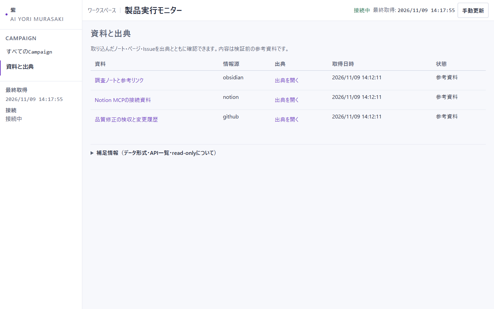

# ai-yori-murasaki

ブルーチーム（防御側）の検知・調査・修復と、パープルチーム（攻撃側との協調による継続的な改善）の両方の機能を、AIが自動で行うPythonツールです。AIが模擬アプリへの攻撃・不審アクセスの検知・原因の調査・直し方の提案までを代行し、その結果が本当に正しいかをAIを使わない自動検査で確かめます。模擬アプリは隔離された環境の中だけで動くため、外部の実システムには影響しません。



白基調に変更したモニターです。本文18px・見出し24pxで、取り込んだ資料の出典を開けます。画像は2026-11-09の画面検証用資料で、実サービスから取得したデータではありません。

## できること

模擬アプリを隔離されたコンテナの中でだけ動かし、外部の実システムには影響させません。攻撃役のAIが実際にアクセスを試み、監視役のAIがアクセス記録（ログ）だけから不審なアクセスを見つけ、修復役のAIがコードを読んで原因を特定し、直し方の案を作ります。

直した後の確認も自動です。攻撃が確かに遮断されたか、通常の機能が壊れていないかを、AIを使わない自動検査が実際の応答で判定します。AIの自己評価は使いません。

見つけた問題は、深刻度（CVSS）と悪用される可能性（KEV/EPSS）で整理され、どれから対処すべきかの判断を助けます。

実行の記録は、誰がいつ何をしたか、AIが何を選んだかがすべて残り、後からの書き換えがあると検知できます。

AIへの指示や作業の予算を過去の失敗から自動で調整し、改善が本当に役立つかを、使っていない場面でも試してから採用を判断します（RSI）。

実行の様子、見つけた問題、直した結果、改善の候補は、ブラウザーのHTMLモニターで確認できます。

Obsidianのノート、Notionのページ、GitHub Issueを、出典・関連リンク付きの参考資料として手動で取り込めます。ファイルとMCPの読取に対応し、モニターの「資料と出典」で本文を確認できます。[設定と使い方](docs/SOURCES.md)を参照してください。

## 動作の流れ

1. 攻撃役のAIが、模擬アプリにリクエストを実際に送り、アクセス制限が破られていないかを確かめます
2. 監視役のAIが、アプリのアクセス記録だけを見て、不審なアクセスを報告します。攻撃役の計画は監視役に見せません
3. 修復役のAIが、対象のコードを読み、原因を特定し、直し方の案を提出します
4. 判定係（AI不使用）が、直した後で攻撃が失敗すること、通常の機能が動くことを確認します
5. すべての手順と証拠が記録に保存されます

AIが不審なアクセスを見落とす、作業が時間切れになる等の失敗は、そのまま失敗として記録されます。用意しておいた正解に黙ってすり替えることはありません。

## 確かめたこと（証跡）

- 2026-11-09: 資料取り込みと白基調・文字拡大を実装し、全体657 passed / 3 skipped / 22 subtests passedでした。ローカルMCPのstdio／HTTP接続と実ブラウザーを確認しています。実Notion／GitHubアカウントへの接続は認証設定がないため未実行です ([AC-20261109-02](docs/acceptance/AC-20261109-02.md))

- 2026-11-09: 同じpath・role・categoryの別アクセスを重複として失う問題と、RSIで適用したbundleが通常実行へ反映されない問題を再現・修正しました。承認状態・使用bundleのhash照合・破損拒否・ロールバックをクラウドLLMなしで確認し、全体回帰は637 passed / 3 skipped / 22 subtests passedでした。実モデルによる検知能力やRSI性能の向上は新たに主張していません。SQLi修復・実WazuhのBlue評価・異なるRSI候補の実比較は設計とTask化までです ([AC-20261109-01](docs/acceptance/AC-20261109-01.md))

- 2026-11-08: アクセス権の設定漏れと判定の書き間違いの2種類の脆弱性で、最初から最後までの流れを実環境（Docker + Ollamaの実モデル）で確認しました。修復役のAIは、それぞれの原因に合わせた異なる直し方を作りました ([AC-20261108-01](docs/acceptance/AC-20261108-01.md))
- 2026-11-08: ローカルの認可環境で稼働するWazuhへ接続し、API認証と監視サーバーの状態確認が成功しました。変更前の実接続スモークでは、保存済みの実アラート187件の取り込みを確認しました。外部レビューを受け、今回の変更では観測値を保つ正規化イベントを既定の出力とし、HTTP形式の擬似値への変換を実験用デモでの明示的な選択に限定しました。変更後の動作は下記の自動テストで確認しています。APIによるアラート検索は未確認です ([実行記録](docs/evidence/wazuh-live-20261108.md))
- AI手順の改善（RSI）: 実行したところ改善の候補は元のまま変わらず、比較でも良くなりませんでした。不採用としました。正直な結果として記録しています
- 5類型の採点: 権限・SQLインジェクション・XSS・許可範囲外のファイル参照・依存部品の既知の脆弱性の5種類で、従来の評価経路で全項目合格しています ([AC-20261107-03](docs/acceptance/AC-20261107-03.md))
- 自動テストは607 passed / 2 skipped / 22 subtests passedでした。Wazuhの取り込み10件とスモーク判定4件も成功しています ([検収記録](docs/acceptance/AC-20261108-01.md))
- 限界: 外部ツール（Trivy、CodeQL等）は接続試験まで。Wazuhは認可ローカル環境でのAPI認証・状態確認・保存済みアラートのファイル取り込みまでを実測しました。標準manager APIの`/alerts`は404で、Indexerによる検索は未検証です。修復の自動再検証は認可不備の1系統のみ実装で、Oracleの他類型（SQLi/XSS等）向けkindは未実装です。未知パターンへの検知性能の評価は未実施です。クラウドのモデル名による特定バージョンの保証はしません

証跡の一覧は[検収一覧](docs/acceptance/INDEX.md)と[実行記録](docs/evidence/)にあります。

## クイックスタート

前提は Python 3.11以上、Docker（Linuxコンテナ実行環境）、Ollama（`glm-5.3:cloud`と`deepseek-v4.1-flash:cloud`を登録し、cloudモデルを利用できる状態）です。cloneしたリポジトリのルートで実行します。

```powershell
py -3 -m pip install .
docker build -t ai-yori-murasaki-lab:1 ai_yori_murasaki/lab_assets
$RuntimeRoot = '<リポジトリ外の作業用ルート>'
$env:AYM_WORKSPACE = Join-Path $RuntimeRoot 'workspace'
$env:AYM_TRUSTED_ROOT = Join-Path $RuntimeRoot 'trusted'
New-Item -ItemType Directory -Force -Path $env:AYM_WORKSPACE,$env:AYM_TRUSTED_ROOT,(Join-Path $RuntimeRoot 'staging') | Out-Null
aym lab demo --staging-root (Join-Path $RuntimeRoot 'staging')
aym monitor serve --bind 127.0.0.1:8765
```

モニターは http://127.0.0.1:8765 で開きます。作業用ディレクトリの考え方など、詳しい手順は次の「起動」と[RUNBOOK](RUNBOOK.md)にあります。

## 起動

Python 3.11以上、DockerのLinuxコンテナ実行環境、Ollamaを使用します。Ollamaには`glm-5.3:cloud`と`deepseek-v4.1-flash:cloud`を登録し、cloudモデルを利用できる状態にします。

```powershell
# リポジトリをcloneした場所に移動する
Set-Location <clone先のリポジトリルート>
py -3 -m pip install .
docker build -t ai-yori-murasaki-lab:1 ai_yori_murasaki/lab_assets

# リポジトリの外に、互いに重ならない作業用ディレクトリを用意する
$RuntimeRoot = '<リポジトリ外の作業用ルート>'
$env:AYM_WORKSPACE = Join-Path $RuntimeRoot 'workspace'
$env:AYM_TRUSTED_ROOT = Join-Path $RuntimeRoot 'trusted'
$StagingRoot = Join-Path $RuntimeRoot 'staging'
New-Item -ItemType Directory -Force -Path $env:AYM_WORKSPACE,$env:AYM_TRUSTED_ROOT,$StagingRoot | Out-Null
aym lab demo --staging-root $StagingRoot
aym monitor serve --bind 127.0.0.1:8765
```

[製品実行モニター](http://127.0.0.1:8765)を開きます。
モニターは読み取り専用です。ラボを再実行する場合は、同じ環境変数を設定した別の端末を使います。

詳細は[RUNBOOK](RUNBOOK.md)と[製品操作ガイド](docs/PRODUCT-GUIDE.md)を参照してください。

## モニター

実行の様子は、ブラウザーのHTMLモニター（http://127.0.0.1:8765、読み取り専用）で確認できます。

- 主要な指標と詳細を分けて表示し、実行の進み具合、見つけた問題（深刻度やCVSSなど）、修復と再検証の結果を追えます
- agentごとの活動と、失敗がどの候補・手順に属するか（帰属）も表示されます
- RSIの改善候補と、採用・不採用の判断材料も確認できます
- 自動更新されても、見ている場所やスクロール位置は保持されます
- 「資料と出典」で取り込んだ本文、原本へのリンク、関連リンクを確認できます

画面の見方は[製品操作ガイド](docs/PRODUCT-GUIDE.md)にあります。

以前の[campaign画面](docs/images/monitor-campaign.png)は、2026-11-08の実ランの証跡として保存されたモニターAPI応答（[docs/evidence/agent-core-20261108/monitor/](docs/evidence/agent-core-20261108/monitor/) の campaign 詳細と RSI）を再生した記録です。run一覧・モデル・アダプタ・評価は、再生に使える記録が保存されていないため空の表示になっています。旧配色の画面全体は [monitor-campaign-full.png](docs/images/monitor-campaign-full.png) にあります。

## 文書と要件

Workflow CookbookのTier 3（Full）を採用しています。[導入対応表](docs/workflow-adoption.md)に適用範囲とテンプレート版を記録しています。

<!-- LLM-BOOTSTRAP v1 -->
作業開始時は[HUB.codex.md](HUB.codex.md)と[GUARDRAILS.md](GUARDRAILS.md)を読み、必要な原文へ進みます。Birdseyeは[index.json](docs/birdseye/index.json)から参照します。未登録・破損・鮮度不明の場合は通常検索で原文に戻ります。
<!-- /LLM-BOOTSTRAP -->

| 文書 | 内容 |
| --- | --- |
| [要件](docs/requirements/REQUIREMENTS.md)・[判断](docs/requirements/DECISIONS.md) | 原典調査と要件の採否 |
| [Core仕様](docs/requirements/SPEC-CORE.md)・[評価仕様](docs/requirements/SPEC-EVALUATION.md) | データ、権限、Oracle、RSI、測定 |
| [API契約](docs/requirements/API-CONTRACTS.md) | CLIと監視API |
| [BLUEPRINT](BLUEPRINT.md)・[EVALUATION](EVALUATION.md) | 範囲と検証条件 |
| [RSI方針](docs/RSI.md) | 自己改善の9項目 |
| [Task](docs/tasks/README.md)・[検収](docs/acceptance/INDEX.md)・[CHANGELOG](CHANGELOG.md) | 作業と証跡の追跡 |

要件の起点となった受領レポートは、再配布権が未確認のため非公開の保存資料としてローカルで保持しています（リポジトリには含まれません）。原文の提案値と、この製品で確認した値は区別します。

## 公開状態

このリポジトリはGitHub Publicで公開しています（https://github.com/RNA4219/ai-yori-murasaki ）。現在の公開版は v0.1.1 の[GitHub Release](https://github.com/RNA4219/ai-yori-murasaki/releases/tag/v0.1.1)です（配布物のsdist/wheelを添付）。初回公開は v0.1.0 です。リモートCIは設定しておらず、CIバッジ等は表示しません。本番環境は対象外です。公開の承認と実行状態は[公開記録](docs/releases/README.md)（RA-20261107-01、RA-20261108-01、RA-20261108-02）に残します。
