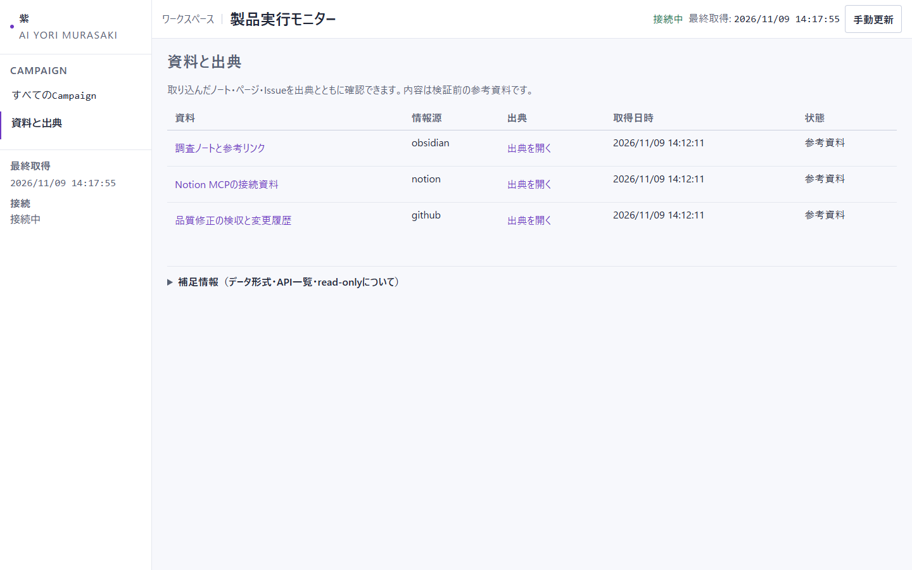
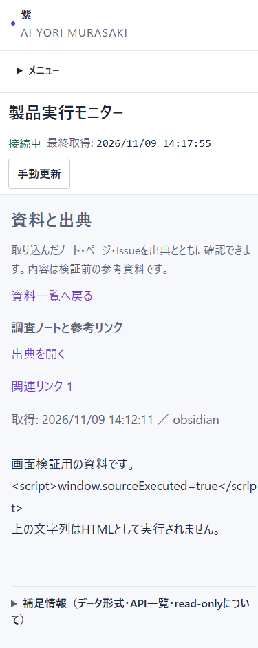

# 資料インポートと画面の検証記録

開始HEADは `dbffaac02a740499b72e33c9a0a943e4bff1693d`。依頼はObsidian／Notion／GitHub IssueのMCP対応、出典リンク、白基調と文字拡大。既存の未追跡スクリプト4本は変更していない。Codex代行はこのセッションのユーザー承認による。

## 実装と選択理由

operatorの手動CLIを取り込み入口とし、既存HTTPは読取専用のまま資料一覧・本文を追加した。任意ツール実行やWeb書込APIは、既存の権限境界を広げるため採用しない。資料は独立したCASと索引で管理し、既存FindingやOracleへ混ぜない。出典URLと関連リンク、内容hash、更新前参照を保持する。出典は操作者の指定値であり、外部本文の正しさを証明しない。

MCPは公式SDK2.3.0のClientを追加依存にし、stdioとStreamable HTTPで単一の許可読取ツールを呼ぶ。OAuth認証画面や自動巡回は追加していない。白基調・本文18px／補助16px以上・見出し24pxを既存のCSS tokenに反映した。

## 自動検証

```powershell
uv sync --extra mcp --python C:/Users/ryo-n/AppData/Local/Programs/Python/Python311/python.exe
uv run --extra mcp --with pytest==9.0.2 python -m pytest -q -rs --tb=short --durations=5
uv run --extra mcp --with pytest==9.0.2 python -m pytest tests/test_v1_server.py -q --tb=short
```

同期成功。全体は[657 passed / 3 skipped / 22 subtests passed、128.40秒](pytest-all.txt)、終了0。新規20ケースを含む。最後に見出しサイズだけ調整したため、監視API／HTMLの関連試験を再実行し、[24 passed、13.62秒](pytest-final-html.txt)、終了0。外部LLM、Docker、利用者の外部アカウントには接続していない。

`tests/test_sources.py` は再取り込み・過去版、UTF-8 Obsidian、パス・URL・サイズ制限、CAS破損、CLI、operator／Blue境界、書込ツール拒否、実SDKのstdio3情報源、bearer付きローカルHTTPを確認する。ローカルMCPの本文はfixtureであり、実サービスのデータではない。3 skippedは従来からあるWindowsのsymlink権限制約。

途中の失敗も保持する。[最初の試験](pytest-first-test-argument-error.txt)はhandle_requestの引数位置が誤り、[次の試験](pytest-http-fixture-start-error.txt)はStarletteのmiddleware登録方法が現行SDK依存と不一致だった。どちらもテスト側を修正した後、全体回帰で確認した。途中の失敗を成功件数へ加算しない。

前回P0/P1全体は124.39秒、今回128.40秒。新規20ケースを含み、実行条件は完全同一ではない。今回は既存のCLI E2E14.61秒と実方策の記録確認9.46秒が長い。ローカルMCP通信は時間上限内に完了し、異常な待機は観測しなかった。所要時間だけで非効率と判断せず、必要な検査で終了した。

## 実ブラウザー

ローカルStoreへ3件の「画面検証用」資料を投入して製品serverを起動し、Playwrightで操作した。これは実データの再生や実サービス接続ではない。Obsidian本文にscriptタグを文字列として入れ、実行されないことを確認した。

最終測定は[ui-check.json](ui-check.json)。1440pxと390pxの両方で本文18px・見出し24px、文書の横はみ出しなし。背景は `rgb(247, 248, 252)`、面は白。原本と関連リンクは別タブ用の `noopener noreferrer` 付き。更新ボタンへキーボードでフォーカスしEnterを押した後も、同ボタンにフォーカスが残ることを観測した。

axe-core4.14.0を検証時だけ注入し、WCAG 2 A/AAと2.1 AAを実行した。両幅とも違反0件。製品へ外部スクリプトやaxeを同梱していない。自動検査は見た目の好みやアクセシビリティ全体の保証ではない。





## 文書と未実行

Tier／Acceptance／Birdseye鮮度検査はいずれも終了0。結果は `documents-*.txt` に保存した。日本語13文書のlint・差分または資料照合・最終稿hash照合は `yomiyasu-summary.json` に記録する。残した「版」はCAS履歴・配布バージョン、「台帳」「正本」「ゲート」は既存契約の用語として使っている。チェックリストとCHANGELOGの区切りは既存様式を保持した。資料にない名前や数値の候補は、コード・実行ログ・画面測定と照合した。検査件数は読みやすさの点数ではない。製品コードとテスト、画面証跡のhashは `verification.json` に残す。

実利用者vaultと実Notion／GitHub MCPは、対象・認証・接続設定がないため未実行。ブラウザーOAuth認証、token更新、自動同期、全ページ巡回は提供しない。外部本文は未検証の参考資料に留まり、LLM検知・修復・RSI性能の成功主張は追加しない。[検収](../../acceptance/AC-20261109-02.md)と[使い方](../../SOURCES.md)を参照する。
